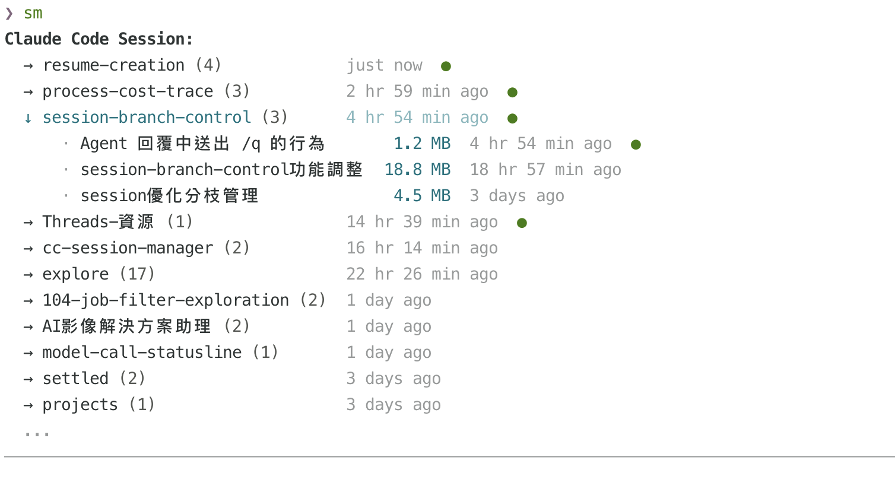
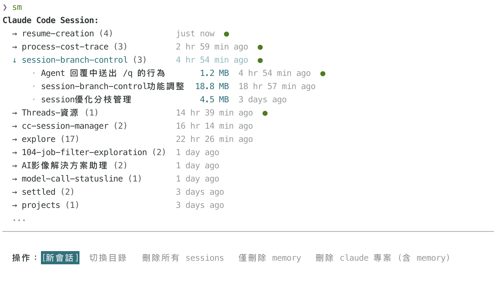
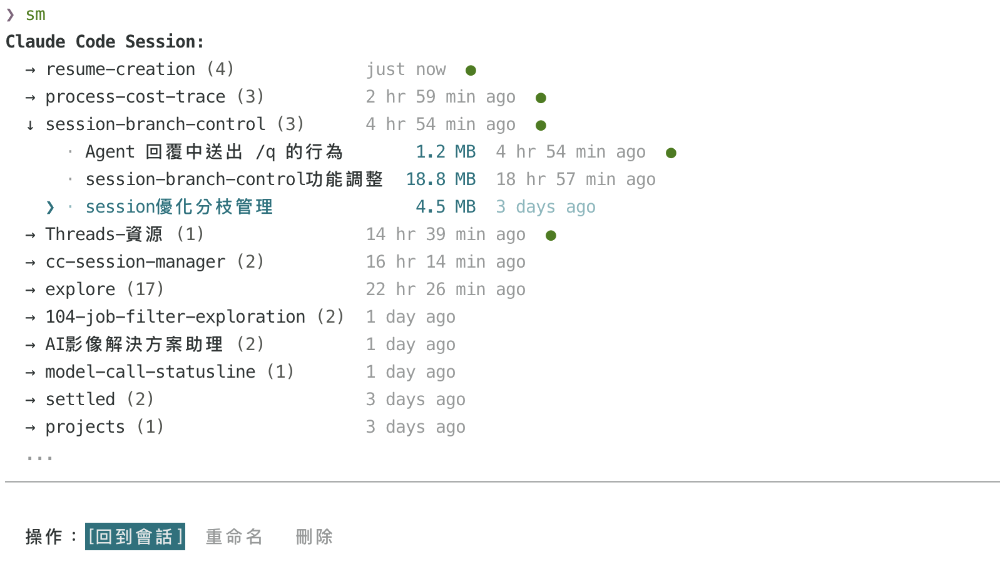

# cc-session-manager

**一個指令 `sm`，看見你所有專案的 Claude Code 對話，選一個直接接續。**

`claude -r` 只列得出目前目錄的 session；專案一多，常常忘了「上次那段對話在哪個目錄、叫什麼名字」，`~/.claude` 裡的舊紀錄也越堆越多。
`sm` 把所有專案的 session 整理成一棵樹：哪些還開著、多大、多久前聊過，一眼看清楚；選定後直接接續對話，**離開時還會自動 `cd` 回那個專案目錄**。



---

## 特色

### 1. 所有專案一覽，進行中的一眼看出

- 依專案目錄分組，顯示 session 數量與最後活動時間，最近的在最上面
- 展開目錄可以看到每段對話的名稱、檔案大小
- 🟢 綠點表示**正在執行中**的 session（會實際檢查程序是否還活著，不會被 cc 崩潰後殘留的紀錄誤判）

### 2. 選目錄：開新會話、切換目錄、清理舊紀錄

選中一個專案按 `Enter`，可以在那個目錄開新會話、直接 `cd` 過去，或清掉不要的 sessions 和 memory。
「刪除 claude 專案」只刪 `~/.claude/projects/` 底下的紀錄，**不會動到你的實際專案目錄**。



### 3. 選 session：接續、重命名、刪除

選中一段對話按 `Enter`，就會在原本的專案目錄用 `claude -r` 接續；也可以幫它取個好認的名字，或刪掉。
正在執行中的 session 會擋下刪除；刪除類操作都要二次確認。



### 其他

- 🖱️ 方向鍵與滑鼠點選都能操作
- 🔎 專案搬家或改名後，會自動搜尋新位置再接續
- 📍 離開 `sm` 後，終端機自動停在剛才選的專案目錄

---

## 安裝

需要 Node.js 18 以上。

```shell
curl -fsSL https://raw.githubusercontent.com/ayii0111/cc-session-manager/main/install.sh | sh
```

安裝程式會：
1. 把工具裝到 `~/.local/share/sm/`，並在 `~/.local/bin/sm` 建立指令
2. 在 `~/.zshrc` 或 `~/.bashrc` 加入 shell 整合區塊（讓退出後能自動 `cd`，並確保 `~/.local/bin` 在 `PATH` 中）

完成後重開終端機即可生效。

## 移除

```shell
curl -fsSL https://raw.githubusercontent.com/ayii0111/cc-session-manager/main/uninstall.sh | sh
```

會移除指令、安裝檔與 shell 整合區塊，不會動到 `~/.claude` 內的 session 資料。

## 使用

啟動：

```shell
sm
```

| 按鍵 | 動作 |
|------|------|
| `↑ / ↓` | 移動聚焦（也可用滑鼠點選） |
| `→ / ←` | 展開目錄 / 在操作列切換選項 |
| `Enter` | 進入操作 / 確認 |
| `Esc` | 上一步 / 退出 |

### 互動流程

```
瀏覽列表 → Enter → 選擇操作 → （需確認的操作）→ 二次確認
                              → （重命名）→ 輸入新名稱
                              → （一般操作）→ 執行並離開
```

- **目錄**上的操作：新會話、切換目錄、刪除所有 sessions、僅刪除 memory、刪除 claude 專案（含 memory，只刪 `~/.claude/projects/` 下的紀錄，不動實際專案目錄）
- **session**上的操作：回到會話、重命名、刪除
- 刪除類操作都需二次確認，最後一個選項永遠是「取消」

## 運作原理

- **Sessions 來源**：`~/.claude/projects/[slug]/*.jsonl` — 每個 `.jsonl` 是一段 cc 對話紀錄，從中解析名稱、原始專案路徑 (`cwd`)、時間戳
- **活躍偵測**：掃描 `~/.claude/sessions/[pid].json`，並用 `process.kill(pid, 0)` 驗證進程仍存活（避免 cc 崩潰後的殘留 PID 誤判）
- **自動 cd**：`sm` 離開前把目標目錄寫入 `/tmp/sm-cwd`，shell 設定檔裡的 wrapper 函式讀取後執行 `cd`。
  （`cd` 無法由子進程改變父 shell 的目錄，因此必須靠 shell 函式橋接）

## 開發

```shell
pnpm dev          # 用 tsx 直接執行，免 build
pnpm build        # 用 tsup 打包到 dist/index.js
pnpm run reinstall  # 以當前原始碼重新安裝（先移除再安裝）
pnpm start        # 執行 dist/index.js
```

推送 `v*` tag 會由 GitHub Actions 建立 Release 並附上打包檔，`curl` 安裝下載的就是最新 Release。

原始碼結構與架構說明見 [`CLAUDE.md`](./CLAUDE.md)，開發者安裝流程見 [`INSTALL.md`](./INSTALL.md)。

## 已知問題

邊界情境與待修清單見 [`KNOWN_ISSUES.md`](./KNOWN_ISSUES.md)。
